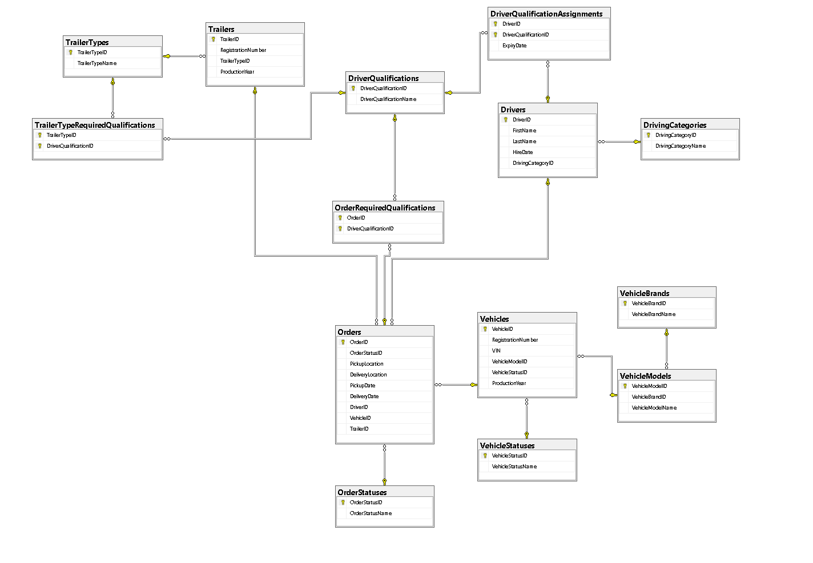

# Transport Fleet Database

A relational database for a heavy-truck transport company, built from scratch in **Microsoft SQL Server** as a portfolio project.
It covers the full path from design to analysis: lookup tables, main tables, link tables, sample data and business queries.

## What it models

- A fleet of heavy trucks (Volvo, DAF, Mercedes-Benz) and trailers of six types
- Drivers with a driving category (C or C+E) and additional qualifications that expire (ADR, Code 95, Tachograph Card, ...)
- Transport orders that may require specific qualifications, either directly or through the type of trailer used
- The question the database is built to answer: **which driver can legally take a given order?**

## Tech stack

- Microsoft SQL Server (T-SQL)
- SQL Server Management Studio (SSMS) 22

## Database diagram



## Project structure

| File | Purpose |
|---|---|
| `sql/01_create_database.sql` | Creates the `TransportFleet` database (drops and recreates it if it exists) |
| `sql/02_create_dictionary_tables.sql` | Creates the 7 dictionary (lookup) tables |
| `sql/03_insert_dictionary_data.sql` | Fills the dictionaries |
| `sql/04_create_main_tables.sql` | Creates the main tables and link tables |
| `sql/05_insert_sample_data.sql` | Inserts sample drivers, vehicles, trailers, qualifications and orders |
| `sql/06_business_queries.sql` | Business queries (read-only) |
| `docs/erd.png` | Entity relationship diagram |

## How to run

1. Open SSMS and connect to your SQL Server instance.
2. Run the scripts in numeric order, from `01` to `06`.
3. Check the structure:

```sql
SELECT name FROM sys.tables ORDER BY name;
```

You should see 14 tables. Expected row counts after running `05`:

| Table | Rows |
|---|---|
| `Drivers` | 6 |
| `Vehicles` | 6 |
| `Trailers` | 6 |
| `DriverQualificationAssignments` | 19 |
| `TrailerTypeRequiredQualifications` | 2 |
| `Orders` | 8 |
| `OrderRequiredQualifications` | 1 |

Every script is **re-runnable**: it clears or drops what it created before creating it again, so a full rebuild is safe at any time.
When rebuilding, always start from `01`: once the main tables exist they reference the dictionary tables, so the dictionaries cannot be dropped on their own.
`01_create_database.sql` deletes the whole database, so use it only on a demo or test server.

## Database structure

14 tables in total.

### Dictionary tables (7)

| Table | Content |
|---|---|
| `VehicleBrands` | Volvo, DAF, Mercedes-Benz |
| `VehicleModels` | Models per brand (FH, FH16, FM, XF, XG, CF, Actros, Arocs, Atego); FK to `VehicleBrands`, unique per brand + model name |
| `DrivingCategories` | C, C+E |
| `TrailerTypes` | Curtainsider, Refrigerated, Box, Flatbed, Tanker, Tipper |
| `VehicleStatuses` | Available, On Route, In Service, Out of Service |
| `OrderStatuses` | New, Assigned, In Progress, Completed, Cancelled |
| `DriverQualifications` | ADR, Forklift License, Crane Operator, Oversize Load Transport, Code 95, Tachograph Card |

### Main tables (4)

| Table | Content |
|---|---|
| `Vehicles` | Registration number, VIN, model, status, production year |
| `Trailers` | Registration number, trailer type, production year |
| `Drivers` | First name, last name, hire date, driving category |
| `Orders` | Status, pickup and delivery location and date; driver, vehicle and trailer are optional (an order can exist before it is assigned) |

### Link tables (3, many-to-many)

| Table | Meaning |
|---|---|
| `DriverQualificationAssignments` | Which driver holds which qualification, with an `ExpiryDate` (composite primary key: driver + qualification) |
| `TrailerTypeRequiredQualifications` | Qualifications required by a trailer type (Tanker needs ADR, Flatbed needs Oversize Load Transport) |
| `OrderRequiredQualifications` | Qualifications required by a specific order |

## Design decisions

- **Named constraints** everywhere (`PK_`, `UQ_`, `FK_`), foreign keys follow the pattern `FK_Table_ColumnName`. Named constraints give readable error messages and make later changes easy.
- **`dbo.` prefix** on every object, so there is no ambiguity about the schema.
- **Plain dictionaries.** Lookup tables contain only values; business rules live in the relational and link tables.
- **Many-to-many relationships through link tables** instead of repeated columns (a driver can hold many qualifications, an order can require many).
- **Expiry dates instead of an active/expired status.** A status column would go out of date by itself, a date never does. Whether a qualification is valid is always calculated from the date.
- **Requirements are derived, not copied.** The qualifications needed for an order are the order's own requirements plus the requirements of the trailer type assigned to it. Trailer type requirements are looked up through the trailer, they are not duplicated into each order.
- **Optional order assignment.** Driver, vehicle and trailer in `Orders` can be `NULL`, so unassigned orders are possible. Queries and data scripts use `LEFT JOIN` where such rows must not disappear.
- **Dictionary values are looked up by name, not by hard-coded ID** in the data scripts (`INSERT ... SELECT ... JOIN`), so the data scripts do not depend on identity values.
- **Re-runnable scripts** with identity reseeding after clearing tables.

## Sample data

The data is made up and designed to cover different cases for the queries:

- 6 drivers, 6 vehicles and 6 trailers (one trailer of each type)
- 19 qualification assignments: valid, expiring soon and already expired
- 8 orders in different statuses: orders 1-5 are assigned to a driver, vehicle and trailer, orders 6-8 are unassigned
- Trailer type rules: a tanker requires ADR, a flatbed requires Oversize Load Transport
- One order (Szczecin to Rostock) that explicitly requires Oversize Load Transport

Query 3 depends on the day it is run, because it uses the current date. The sample expiry dates are set around October 2026, so the exact result of that query changes over time.

## Business queries (`sql/06_business_queries.sql`)

| # | Question | Techniques |
|---|---|---|
| 1 | Which vehicles are available? | Multi-table `JOIN`, filter by status name |
| 2 | Which driving category and qualifications does each driver have? | `LEFT JOIN`, `STRING_AGG ... WITHIN GROUP`, `GROUP BY` |
| 3 | Which qualifications have expired or expire within 30 days? | `GETDATE`, `DATEADD`, `DATEDIFF`, `CASE` |
| 4 | How many orders has each driver had? | `LEFT JOIN`, `COUNT(column)` vs `COUNT(*)`, tie-breaker in `ORDER BY` |
| 5 | Which drivers can take a given order? | `DECLARE`, double `NOT EXISTS` (relational division) |
| 5b | Same, but qualifications must be valid on the order's delivery date | Variable filled by a subquery, date condition inside the `NOT EXISTS` |
| 5c | Same, but requirements come from the order and from the assigned trailer type | CTE, `UNION`, `STRING_AGG`, double `NOT EXISTS` |

Queries 5, 5b and 5c take the order from a variable: change `@OrderID` to check another order.

### Expected results for the matching queries

| Order | Requirements | Drivers returned |
|---|---|---|
| 7 (Szczecin to Rostock) | Oversize Load Transport (set on the order) | Nowak only |
| 5 (Gdynia to Hamburg, Tanker trailer) | ADR (from the trailer type), visible in 5c | Kowalski, Nowak, Wójcik |
| 1-4, 6, 8 | none | all 6 drivers |

Query 5 and 5b look only at requirements set directly on the order, so for order 5 they return all drivers; only 5c adds the ADR requirement implied by the Tanker trailer.
Setting `@DeliveryDate` manually after the `DECLARE` (for example to a date after Kowalski's ADR expires on 2026-11-15) shows the date check at work.

## Roadmap

- [x] Dictionary tables and data
- [x] Main tables
- [x] Link tables (many-to-many)
- [x] ERD diagram
- [x] Sample data
- [x] Business queries 1-5, 5b, 5c
